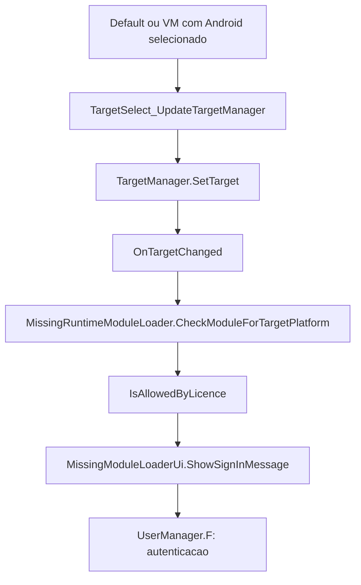

# Entradas de login e continuacoes locais

Mapa estatico das DLLs IDE/Build 2026.0.0.16 e do host Android. Nao equivale a um teste de cada toque no aparelho. O log fornecido anteriormente nao captura o novo toque em Default.

## Default, VM e selecao Android

O patch anterior tratava apenas `gadget.Tag == "android"`. A selecao visual de Android pode continuar marcada na lista. Clicar em Default (Dispositivo) ou VM reaplica a selecao das tres colunas pelo handler original.

O metodo CheckModuleForTargetPlatform verifica a licenca antes de verificar se o modulo esta instalado. Por isso o dialogo de login pode surgir mesmo com o runner ja embutido.

A correcao no host considera a plataforma, runtime e dispositivo efetivamente selecionados. Android/VM/Default seguem para a sessao local de APK sem reaplicar o alvo pelo caminho original. YYC ou dispositivo remoto recebem uma mensagem de capacidade nao suportada. Eventos programaticos sem gadget/indice continuam no handler original; os outros alvos tambem. A sessao de exportacao e idempotente porque VM tem dois callbacks de selecao no Build.dll.

## O que existe depois da autenticacao

| Entrada | Verificacao que pode chamar login | Continuacao da acao local | Estado neste patch |
| --- | --- | --- | --- |
| Android, VM, Default na selecao Android | MissingRuntimeModuleLoader.CheckModuleForTargetPlatform -> ShowSignInMessage | Validar modulo real e aplicar selecao; no host Android, preparar e exportar APK local | Encaminhado para exportacao local |
| Comando nativo try_package_program | IDE.TryPackageProgramImpl -> IsLoggedIn -> SignInDialog | Se autenticado, chama package_program; PackageAndroid salva o projeto, abre seletor de saida e chama DoAndroidPackageBuild | Mapeado; wrapper nativo ainda possui login. Usar a entrada APK local |
| Menu Build e dicas de Create Executable | WindowManager.SetLicenseLimitedState | Habilitar controles de compilacao e exportacao | Mapeado; o estado visual original ainda depende da conta |
| Modulo ausente | MissingRuntimeModuleLoader: depois da verificacao de permissao consulta IsModuleInstalledForActiveRuntime | Confirmar instalacao e instalar o modulo | Uma instalacao ausente precisa ser resolvida; login nao substitui binarios |
| Conta da IDE | WindowManager, sign_in_menu -> UserManager.F | Estabelecer sessao da conta | Acao de conta, nao uma etapa necessaria para APK local |
| Publicar/sincronizar Opera GX | PackageProgram, OperaAuthorization, SettingsRequestManager | Obter token e compilar/enviar dados ao servico | Operacao online; requer sessao autentica do servico |
| Default na coluna Configuracao | Metodos de configuracao do TargetSelectButton inspecionados | Atualizar selecao/configuracao do projeto | Nao foi encontrada chamada direta de login nesses metodos; nao confundir com Default de Dispositivo |

Os handlers de SignIn examinados iniciam a autenticacao, mas nao guardam uma continuacao generica para todas as acoes. Em particular, TryPackageProgramImpl chama package_program no ramo ja autenticado; seu callback de login apenas inicia UserManager.F. Nao ha uma unica "tela seguinte" que possa substituir todos os logins.

Para naturalizar o restante do fluxo local, a proxima integracao identificada e fazer o comando nativo try_package_program encaminhar a intencao de exportar Android para a mesma sessao APK, e ajustar o estado dos controles correspondentes. Nao basta fechar o dialogo ou marcar login como concluido: seria necessario preservar projeto, configuracao, intencao de gerar/instalar e disponibilidade real dos modulos.

## Pontos de codigo e evidencia

- `host/BuildTarget.cs`: adaptacao da selecao para exportacao local.
- `host/AndroidTargetSelection.cs`: classificacao Android/VM/Default e limites do fluxo.
- `host/ApkExport/Android/ApkExport.cs`: sessao idempotente, salvamento, compilacao e resultado.
- `YoYoStudio.Runtime.MissingRuntimeModuleLoader.CheckModuleForTargetPlatform` e `MissingModuleLoaderUi.ShowSignInMessage`, em IDE.dll.
- `YoYoStudio.IDE.TryPackageProgramImpl`, `YoYoStudio.GUI.WindowManager.SetLicenseLimitedState`, em IDE.dll.
- `YoYoStudio.Plugins.Build.PackageProgram.PackageAndroid` e `DoAndroidPackageBuild`, em Build.dll.

REA: `ev_81e8fa8b3e3aef10e30fec88d9420ce309b85662373f077a42361a05eabf5a0a` confirma a cadeia de licenca/login do loader; `ev_a0b8427281540b07c25860b953d65cf1f90fe0ccd72277ae4a628ddcb03b0c02` identifica os callbacks e campos do seletor. IDE.dll SHA-256: `e80b812544c09efbe4c650632a838e50eece55bbca69b09677da06506f2a2f09`.

Validacao disponivel: regressao da classificacao de selecoes no host e build Android. Pendente: toque real em Android -> voltar -> Default/VM e confirmacao de ausencia do dialogo no aparelho.
